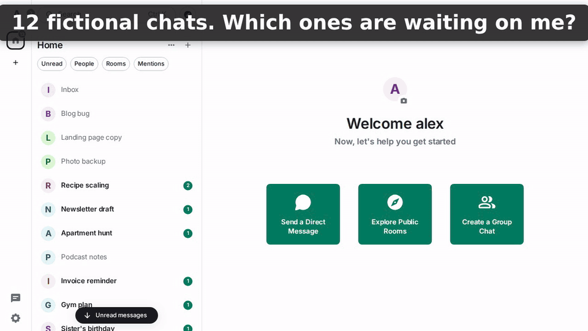

# hermes-ball



*Demo workspace, fictional projects, unedited plugin output. [MP4 (720p)](demo/video/ball-demo-720.mp4)*

**Ball shows which of your AI chats are waiting on you, and what each one asked.**

Ball is a plugin for [Hermes Agent](https://github.com/NousResearch/hermes-agent). If you talk to Hermes in many
chats, it's easy to forget one where the AI asked you a question. Type `!ball` and Ball lists the chats where
the AI is waiting for your reply. Answer one and it drops off the list.

- **Passive.** Ball only answers when you type its command. It never sends messages on its own and never
  changes what the AI sees or says.
- **Local.** No network calls by default. One small SQLite file.
- **Used daily on Matrix and Telegram** (the author's own setup). Other platforms use the same Hermes hooks but
  are untested. On Matrix the command is `!ball`; elsewhere it is `/ball`, and Ball's own hints use the right one. Telegram DM topics arrive without their topic name, so Ball shows Hermes' session title for them instead.

## Install

```bash
hermes plugins install https://github.com/getaskclaw/hermes-ball
hermes plugins list        # check that "ball" is listed
```

Then restart the Hermes gateway so it loads. Requires Hermes `>=0.23.1`.
To remove: `hermes plugins uninstall ball`.

## Use

| Command | Shows |
|---|---|
| `!ball` | the 3 chats that have waited longest, plus counts |
| `!ball all` | every chat waiting on you |
| `!ball here` | this chat's status |
| `!ball done` | the 10 latest 💤 answered chats (`!ball done all`: every one) |
| `!ball all hide` | same as `!ball all`, chat names replaced by Chat A/B/C (for screenshots) |
| `!ball forget` | delete this chat's row |
| `!ball forget stale` | delete every chat hidden for being idle (DM only) |
| `!ball help` | short help |

Cron jobs, API calls and delegated runs (Hermes platform `local`) are left off chat boards: they aren't chats
you can answer, and their questions already reach you through the job's own delivery. `show_local: true` lists them.

`!ball`:

```
🏀 4 chats waiting on you
1. Blog draft · 2d — Delete the old drafts?
2. Photo sorter · 1d — Should I rename the files?
3. Tax notes · 5h — Which file should I write to?
…1 more: `!ball all`
⚠️ 1 AI stalled — send "go" there
1. Deploy helper · 40m
🤖 1 AI working
💤 3 answered — nothing for you to do
```

## What each status means

The headline count ("4 chats waiting on you") counts only 🏀 chats; stalled and working chats get their own lines.

| Status | When | Waiting on you? |
|---|---|---|
| 🏀 Your move | the AI's turn ended with a question, a request for a decision, or an approval prompt; or you interrupted it | yes |
| 💤 Done | the AI's turn ended with an answer and no question | no |
| 🤖 AI working | you sent a message and the AI hasn't finished; or its turn ended with a promise ("I'll report back") less than 2 minutes ago | no |
| ⚠️ AI stalled | that promise is older than 2 minutes with no new turn; or "AI working" has lasted 30 minutes (e.g. the gateway restarted) | maybe: open the chat and check |

The phrase rules are in English and Chinese. A question beats a promise, and polite closers such as "Let me know
if you have any questions" don't count as questions. The question shown is copied from the AI's reply by fixed
rules, not summarised by an AI: stored up to 80 characters, shown up to 40.

**Measured accuracy.** On 150 real chat endings that were not used while writing the rules (the author's own
Telegram and Matrix chats, English and Chinese, labelled independently by an LLM):

- "Waiting on you" is right **77%** of the time, and catches **77%** of the chats that really wait on you.
- Promises ("I'll report back") are caught **44%** of the time; missed ones show as Done.
- Overall the three-way status agrees **69%** of the time.

So treat Ball as a reminder, not a guarantee. An optional LLM judge (off by default) can refine the verdict.
The 103 test endings in `tests/fixtures/` keep the rules from regressing; they are not the accuracy figure.

## Settings

```yaml
plugins:
  entries:
    ball:
      settings:
        language: auto          # auto | zh | en
        llm_judge: false        # true = ask your active model to judge each turn end
        llm_judge_timeout: 20   # seconds; on timeout the phrase rules are used
        stale_days: 7           # hide chats idle this many days (0 = never)
        working_timeout_min: 30 # "AI working" this long with no reply shows as stalled (0 = off)
        promise_grace_min: 2    # minutes before a promise counts as stalled (0 = off)
        board_in_groups: here   # here = in a group room, show only that room; all = show every chat
        show_local: false       # true = also list cron/API/delegated runs (platform 'local')
```

`language: auto` replies in Chinese if your last message contains Chinese characters, otherwise in English
(text with Japanese kana counts as English). Set `zh` or `en` to choose.

## Privacy

Ball stores one row per chat in `<HERMES_HOME>/plugin-data/ball/data.db`:

- the chat name, and who has had the ball since when
- the AI's short question (up to 80 characters) or the promise phrase it matched (up to 200)
- the language to reply in

It never stores your messages or the full AI reply.

Outside its own file, Ball reads only Hermes' in-process session routing and, read-only, two things from
Hermes' own `state.db`: the session's origin (platform, chat, thread) when a reply arrives right after a plugin
reload, and the session title Hermes generated, used as the name of a Telegram topic or other chat that has none. By default (`board_in_groups: here`), `!ball all` in a group
room shows only that room, so other chats' names and questions aren't posted where others can read them.
Setting it to `all` shows every chat everywhere.

If you turn on `llm_judge`, the last 2000 characters of the AI's reply go to **your own active model**
(your credentials, your cost), in the background so turns aren't delayed.

## Limits

- **It can misjudge.** Phrase rules are a heuristic; see the measured accuracy above.
- **It never wakes the AI.** "AI stalled" is a flag; you have to reply.
- Chats in the CLI or TUI aren't tracked, only chat platforms.
- Rooms you have left stay in the database until you run `!ball forget stale` (they are hidden after
  `stale_days`).
- If you type `!ball` while the AI is mid-turn, Hermes queues it like any other message, so the answer comes
  after the turn.

## Development

```bash
pip install -r requirements-dev.txt
python -m pytest -q
hermes plugins validate . --install-deps
```

## License

MIT
